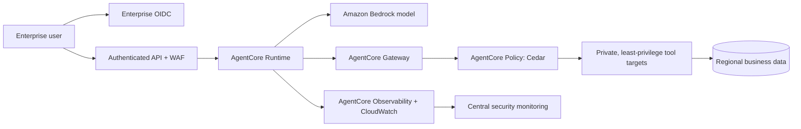

# Enterprise Agent Deployment Architecture Review

**Status:** Proposed baseline
**Decision date:** 2026-10-03
**Scope:** US-resident internal business assistant using Amazon Bedrock and Amazon Bedrock AgentCore. This is a reference design, not an assertion that every AgentCore feature or model is enabled in the selected account or Region.

## Architecture decision record

### Decision

Use a single-region, least-privilege deployment in **US East (N. Virginia), `us-east-1`**, with **US West (Oregon), `us-west-2`** as a manually activated recovery Region. Keep inference, data stores, logs, and backups within the approved US boundary. Before provisioning, verify current AgentCore feature and model availability in both Regions. Do not use cross-Region inference profiles or automatic failover that can move prompts or outputs outside the approved residency boundary. If the workload requires a different jurisdiction, select and validate a compliant Region pair before deployment.

### Model selection

Use an approved **Amazon Nova Pro** model for tasks needing multi-step reasoning and tool selection; route simple, low-risk classification to **Amazon Nova Lite** only if the evaluation suite shows acceptable quality. Pin the exact supported model ID/version and Region in deployment configuration; do not silently follow a moving alias. Confirm current model lifecycle, tool-use support, quotas, and regional availability in the [Bedrock model catalog](https://docs.aws.amazon.com/bedrock/latest/userguide/models-supported.html). Changes to model, prompts, tools, or policies require the release gates in [the evaluation plan](docs/evaluation.md).

### Identity and authorization

Authenticate end users through the enterprise OIDC identity provider and pass only validated identity/tenant claims to the agent. Use separate roles for:

- **Runtime role:** invoke only the approved Bedrock model and required AgentCore resources; read only the specific secrets/configuration it needs.
- **Gateway target role:** invoke only the named backend APIs/Lambdas; no broad account discovery or administrative permissions.
- **CI/deployment role:** publish versioned artifacts and update the designated environment; no runtime data access.
- **Operator/break-glass role:** time-bound, MFA-protected incident actions with CloudTrail auditing.

Keep end-user authorization separate from the runtime role. Enforce tool-level controls in AgentCore Policy (default deny; forbid wins), and enforce object/tenant authorization again in each backend. See [`policies/agent-actions.cedar`](policies/agent-actions.cedar).

### Network and data residency

Expose the application through an authenticated API entry point with WAF/rate limits; do not expose agent or data-store endpoints directly to the internet. Run application components and private tool backends in private subnets with no public IPs. Use VPC endpoints/private connectivity for supported AWS dependencies; tightly restrict egress to explicitly approved destinations, with controlled egress for any external integration. Configure AgentCore Runtime/Gateway network connectivity according to the selected feature's current regional networking support—do not assume all managed service traffic is inside the customer VPC.

Encrypt data in transit and at rest with TLS and customer-managed KMS keys where supported. Minimize prompt and trace content; redact sensitive fields before logging, tightly restrict trace access, and set documented retention/deletion periods. Keep Memory off for sensitive workflows unless its retention, tenant isolation, deletion, and residency behavior are approved. Confirm the location and retention of service-generated telemetry and backups against the organization's data classification requirements before go-live.

### Cost and operational controls

Set per-agent request, concurrency, turn, tool-call, token, and execution-time limits. Apply API throttles and model/service quotas; configure AWS Budgets and anomaly alerts by environment/team. Track cost per successful task, not just raw token volume. Use model routing only after quality and spend are measured; set a hard monthly budget and an operator-owned circuit breaker. Scale from measured demand, and adopt provisioned capacity only when sustained utilization and cost justify it.

### Request flow

The diagram is logical: validate actual service networking, endpoints, and data paths for the chosen Region and account before implementation.

## Supporting artifacts

- [Cedar policy matrix and deploy notes](policies/agent-actions.cedar)
- [Misbehaving-agent incident response runbook](docs/incident-response.md)
- [Agent evaluation and release gates](docs/evaluation.md)

## Public-repository safety

This repository contains design examples only. It must not contain AWS credentials, account-specific secrets, customer data, production identifiers, or raw production traces. Replace sample gateway/tool names and the non-production sample account ID in policy examples, then validate policies against the actual AgentCore Gateway-generated Cedar schema before deployment.

## References

- [Amazon Bedrock AgentCore overview](https://docs.aws.amazon.com/bedrock-agentcore/latest/devguide/what-is-bedrock-agentcore.html)
- [AgentCore Runtime](https://docs.aws.amazon.com/bedrock-agentcore/latest/devguide/agents-tools-runtime.html)
- [AgentCore Policy](https://docs.aws.amazon.com/bedrock-agentcore/latest/devguide/policy.html)
- [AgentCore Cedar common patterns](https://docs.aws.amazon.com/bedrock-agentcore/latest/devguide/policy-common-patterns.html)
- [Bedrock supported models](https://docs.aws.amazon.com/bedrock/latest/userguide/models-supported.html)
